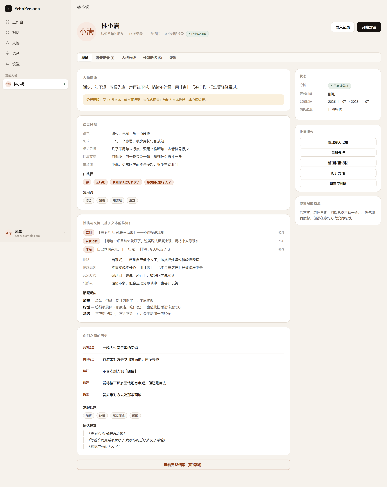

# EchoPersona

> 把一段真实的聊天记录，还原成一个可以继续对话、还能开口说话的 AI 人格。

<p align="center">
  
</p>

<p align="center">
  <a href="https://echopersona.app.workbuddy.host/?sharecode=LINJSW6HQP"><b>▶ 在线体验</b></a>
  ·
  <a href="#快速开始">本地跑起来</a>
  ·
  <a href="docs/ARCHITECTURE.md">技术设计</a>
  ·
  MIT
</p>

---

## 这是什么

你手上有一段和某个人的聊天记录。你想再和 TA 说说话——不是问一个 AI「假装你是我的朋友」，
而是那种具体的、会用 TA 的方式回你的对话。

EchoPersona 做的事：**先把这个人测量出来，再让模型去模仿这个测量结果。**

它不上来就让模型「扮演一个温柔的朋友」。它先做统计——平均句长、短句占比、表情率、
句末有没有标点、谁更常主动开口——再用 LLM 归纳语气、口头禅、回避什么话题。
这些结论会带上置信度和文本证据，你能看见它是**凭什么**这么判断的，也能手动改。

然后对话时，它不会把全部历史塞进 prompt，而是按当前话题检索：
把**这个人真实说过的原话**和真实问答片段找出来，插在提示词末尾。
这一条是「像不像」的决定性因素——形容词摘要只能演一个泛泛的人，原话才能演这一个。

<p align="center">
  
</p>

---

## 在线体验

**https://echopersona.app.workbuddy.host/?sharecode=LINJSW6HQP**

这是一个部署在 **WorkBuddy** 上的**体验版**，用来让人不用装环境就能看到成品长什么样。
点开、注册一个邮箱账号就能进去。

有两点先说清楚，免得你白试：

- **站点不内置任何公共密钥。** 对话和人格分析要跑，你得在「设置 → API 配置」里填**自己的**
  LLM API Key（任何 OpenAI 兼容接口都行）。没填的时候，页面会明确告诉你需要先配置，
  不会拿假数据糊出「成功」的假象。语音功能同理，是可选项。
- **体验版可能会被重置**，也不适合放真实数据。想认真用，按下面的方式在自己机器上跑，
  数据完全在你自己手里。

想先看看**没有任何 Key 时流程长什么样**，本地有个模拟上游（见下方「没有 API Key 也能先看流程」）。
它会返回明确标注「模拟回复」的示例内容——验证的是流程通不通，不是效果好不好。

---

## 它具体做什么

**导入** · TXT / JSON / CSV / Markdown / ZIP，拖拽多选、解析预览、自动去重、
发送者映射修正（把「谁是谁」认错了可以改）。微信加密库这类格式会直接告诉你解析不了，
不假装成功。

**分析** · 确定性统计（句长分布、短句占比、表情率、标点习惯、主动率）+ LLM 结构化归纳。
每条结论带置信度与文本证据，标注「文本推断，非心理诊断」。支持手动修正、增量分析。

**长期记忆** · 自动切块、中文分词建 FTS5 索引、可选向量召回、RRF 混合排序、
按重要度与时间衰减重排。可搜索、编辑、删除、手动新增。不是把历史全塞进 prompt。

**对话** · 多会话、SSE 逐字流式、停止生成、重新生成、编辑删除、Markdown 渲染、
三种相似度模式（自由 / 自然 / 高仿）、自动记忆召回。

**语音** · Breeze 双协议自动适配（托管版 Breeze Blue / 自建 breeze-tts-2）、参考音色、
声音克隆、逐条合成、缓存命中、失败重试、Range 请求。语音和文字是**两套语体**——
说出来的话有重复、半截话、填充词、没有句末标点，所以走独立的提示词。

**账号与隔离** · 注册 / 登录 / 改密 / 改邮箱 / 会话管理 / 数据导出 / 删除账号。
每个用户的数据严格隔离；管理后台**在接口层面就不查**聊天内容和 API Key。

---

## 三条刻意的设计选择

这三个决定看起来是「少做了」，但都是为了不让产品变成它不该成为的样子。

**AI 被允许说「不记得」。**

大多数陪伴类产品的默认行为是「永远接得住」——问什么都能答，编也要编出来。
这个项目反过来：检索不到相关记忆时，提示词明确要它说记不清了。
因为一个从不失忆的人不像人，而伪造共同经历是在篡改你对一段真实关系的记忆。

**「随机发语音」这个开关被删掉了。**

本来有第三档 mixed：按这个人真实的语音占比掷骰子。实测结果是掷出来的几乎总是文字
（大多数聊天记录里语音占比很低），用户选了「随机」却永远收到文字，体感就是开关坏了。
与其留一个用户既无法预测、也无法验证的随机，不如把选择权直接交回给用户——
只有「只发文字」和「只发语音」两档。相关代码里保留了这段说明，
因为后来的人看到库里还有 `mixed` 会以为是漏处理，其实是**有意废弃**。

**语音条不自动播放。**

微信收到语音从不自己出声。自动播放等于在会议室里打开外放。
语音条挂载时只读元数据拿到时长显示秒数，什么时候听由你点。

---

## 快速开始

需要 **Node.js ≥ 22.5**（用到内置的 `node:sqlite`）。

```bash
git clone https://github.com/0htan1/echopersona.git
cd echopersona

npm ci                # postinstall 会自动准备前端依赖
cp .env.example .env  # 默认值就是本地能跑的那套，不用改
npm run migrate       # 建库，幂等
npm start             # http://localhost:8080
```

打开就是登录页，注册一个邮箱账号即可。**不需要云服务、不需要申请任何 Key 就能启动和登录。**

关于 `.env`：`MASTER_KEY` 留空即可，首次启动会自动生成 `storage/.masterkey`（权限 0600）。
`NODE_ENV` 保持 `development`——如果你在 http 上开 `production` 而 `PUBLIC_URL` 又是 https，
会话 cookie 会带上 `Secure` 属性，浏览器不存它，表现为「登录成功了却还是未登录」。

### 没有 API Key 也能先看流程

```bash
# 终端 A：模拟上游（返回明确标注「模拟回复」的示例数据）
node scripts/mock-upstream.js

# 终端 B：应用（放行本地地址）
SSRF_ALLOW_PRIVATE=1 npm start
```

然后在「设置 → API 配置」里填：

- LLM 地址 `http://127.0.0.1:8790/v1`，Key 随便填，模型 `mock-chat`
- TTS 地址 `http://127.0.0.1:8790`（可选）

全流程能走通。**所有回复都会标注「模拟回复」——它验证流程，不验证效果。**

---

## 常用的几条命令

```bash
npm start              # 启动
npm run dev            # 开发模式（--watch 自动重启）
npm run migrate        # 数据库迁移（幂等）
npm test               # 全部测试（142 项）
npm run preflight      # 发布前检查：拦住"项目目录里还有运行时数据"
npm run smoke          # 冒烟检查，默认查 PUBLIC_URL 或本机 8080
npm run backup         # 手动备份

node scripts/restore.js <备份文件>   # 恢复（需先停服务）
node scripts/mock-upstream.js       # 本地模拟上游
```

---

## 关于第三方登录（可选）

默认**关闭**。开箱只有邮箱 + 密码，不依赖任何外部服务。

想加「微信扫码 / 手机验证码」这类登录，在 `.env` 里配三项：

```bash
EP_CLOUD_ENDPOINT=https://your-cloud-endpoint
EP_CLOUD_APP_ID=your-app-id
EP_CLOUD_PUBLISHABLE_KEY=your-publishable-key
```

这三项**只用于确认登录者身份**，不承载模型调用、不存数据库、不传文件。
不配的时候相关按钮不出现，其余功能一切正常。

它依赖一个可选的 npm 包，装不上也不会让 `npm ci` 失败——
一个只想用邮箱登录的自建用户，不该因为某个闭源 SDK 拉不到就整包装不起来。

---

## 部署

生产环境（systemd + Nginx + HTTPS）完整步骤见 [docs/DEPLOY.md](docs/DEPLOY.md)。

```bash
npm ci --omit=dev
cp .env.example .env && nano .env      # 填 MASTER_KEY / PUBLIC_URL
npm run migrate
sudo cp deploy/echopersona.service /etc/systemd/system/
sudo systemctl enable --now echopersona
```

也提供 `Dockerfile` 与 `docker-compose.yml`。

**升级前请先看一遍 `.env.example` 末尾的清单**——尤其是 `PUBLIC_URL` 和 `TRUST_PROXY`，
这两个配错的表现是「登录成功但立刻掉线」，而且报错信息不会指向真正的原因。

---

## 测试

```bash
npm test        # 142 项
```

- `tests/unit.test.js`（58）— 解析器（含中文键名、引号内换行 CSV）、时间戳格式、ZIP 安全、
  切块、分词、FTS 查询、风格统计、画像归一化、加密往返/篡改/掩码、SSRF 网段判定
- `tests/api.test.js`（54）— 驱动真实 Fastify 应用走完整流程，含假 LLM 与假 TTS 上游、
  数据隔离、限流、管理后台不可见内容、账号删除彻底清理
- `tests/frontend.test.js`（30）— **前端契约测试**。用真实服务器的真实响应去渲染每一个页面，
  专门抓「接口返回的字段名与页面期望不一致」这类接口测试发现不了的缺陷。

另有一批场景级验收脚本（`scripts/verify-*.mjs`），用真实浏览器跑真实交互，
覆盖移动端键盘顶起布局、微信风格界面、语音气泡、导入发送者识别等。
它们需要本机装有 Chrome；浏览器入口统一在 `scripts/lib/browser.mjs`，
可以用 `CHROME_PATH` 指定，找不到会自动探测常见安装位置。

---

## 技术栈

Node.js 22 · Fastify 5 · `node:sqlite`（WAL + FTS5）· undici · 原生 ESM 前端（无打包器）

没有引入构建链是刻意的：前端就是原生 ES module，改完刷新就生效，
不需要等 webpack 转一遍。选型理由和已知限制见 [docs/ARCHITECTURE.md](docs/ARCHITECTURE.md)。

---

## 在用它之前请想清楚

这是给**你自己的关系**用的工具，不是用来拿别人的脸和声音做东西的。

- 只上传你有权使用的聊天记录
- 只克隆你本人、或已获明确授权的语音
- 不得用于冒充他人身份交流、骚扰、欺诈或伪造证据

未经许可克隆他人声音可能侵犯人格权，在部分法域涉及违法。
产物默认带「AI 模拟」标识，请不要去掉它——那是这条边界唯一看得见的记号。

---

## License

[MIT](LICENSE)。可以自由使用、修改、商用、再分发，保留版权声明即可，无担保。
